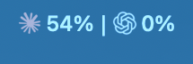
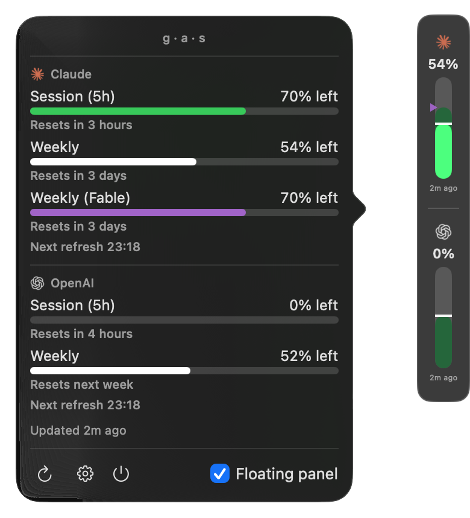
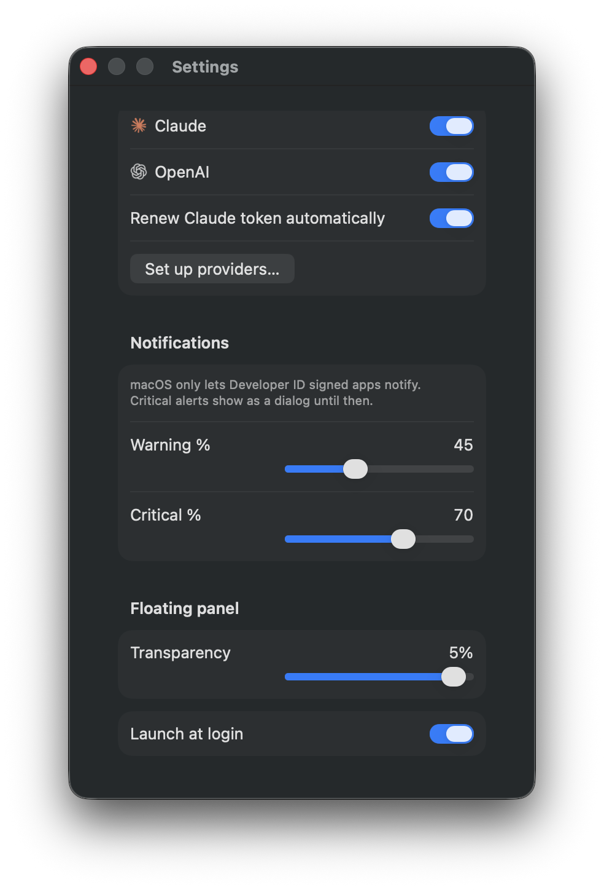

# gas

A macOS menu bar app that shows how much of your **Claude** and **OpenAI (Codex / ChatGPT)** plan you have used: the 5-hour session limit, the weekly limit, and per-model weekly limits.

<p align="center">
  <br><br>
  
</p>

> Unofficial. gas is not affiliated with Anthropic or OpenAI. It reads endpoints that are not documented, so a provider change can stop it until gas is updated.

## Features

- **Menu bar label:** the percent for each provider, at a glance.
- **Menu:** each limit with its percent and reset time, and the time of the next refresh.
- **Floating panel:** a small glass strip that stays on top. Point to its edge to show a pill that switches it between a vertical and a horizontal layout.

  

- **Alerts:** a warning and a critical level (65% and 85% by default) that you can change.
- **Used or Remaining:** show the percent used, or the percent left.
- **First-time setup:** if Claude Code or Codex CLI is missing or signed out, a setup window installs it with the official installer and opens the sign-in page, after one click.
- **Claude token renewal:** when the Claude Code token expires, gas lets Claude Code renew it (see below).
- **Copy diagnostics:** Settings → Troubleshooting copies a report with no tokens in it.

<p align="center">
  
</p>

## Requirements

- macOS 14 or later. The glass look needs macOS 26.
- For Claude: [Claude Code](https://claude.com/claude-code), signed in with a Claude subscription.
- For OpenAI: [Codex CLI](https://github.com/openai/codex), signed in with ChatGPT.

## Install

1. Download the latest `gas-<version>.pkg` from [Releases](../../releases) and open it.
2. gas is not signed with an Apple Developer ID, so macOS blocks it the first time. Click **Done**, open **System Settings → Privacy & Security**, and click **Open Anyway**.
3. When you update, macOS asks to let Installer modify apps. Click **Allow**.

## How it works

| | Claude | OpenAI |
|---|---|---|
| Sign-in it reads | Claude Code's Keychain entry, through `/usr/bin/security` | `~/.codex/auth.json` (or `$CODEX_HOME`) |
| Usage endpoint | `api.anthropic.com/api/oauth/usage` | `chatgpt.com/backend-api/wham/usage` |

- gas refreshes every 5 minutes. A manual refresh is possible once a minute.
- gas only **reads** the sign-ins. It never changes them.
- When the Claude token expires, gas runs `claude -p` one time, which is one short Haiku reply, so that Claude Code renews its own token. gas tries this at most once an hour. You can turn it off in Settings → Providers.
- After a rate limit (HTTP 429), gas waits for the time the server gives. If Claude Code turns out to be signed out, gas shows "Not logged in. Run /login in Claude Code."

## Privacy

- Tokens are never logged, shown, or sent anywhere except the provider's own usage endpoint.
- No analytics, no telemetry. All state stays on your Mac, in `~/Library/Application Support/Gas`.

## Build from source

You need Xcode and [XcodeGen](https://github.com/yonaskolb/XcodeGen).

```bash
swift test
```

```bash
xcodegen generate && xcodebuild -project AgentUsage.xcodeproj -scheme AgentUsageApp -destination 'platform=macOS' build
```

To make the `.pkg` and `.dmg`, see [scripts/README.md](scripts/README.md).

## License

[MIT](LICENSE)
